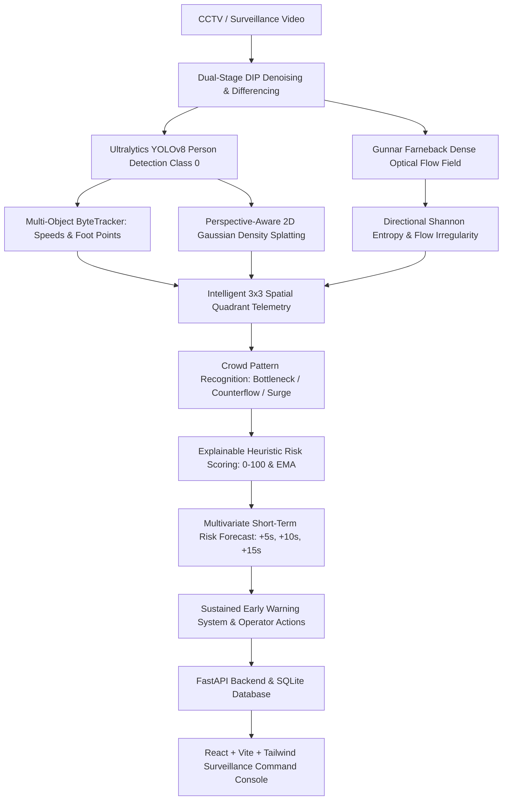

# CROWDGUARD — Digital Image Processing (DIP) Crowd Monitoring & Disaster Prediction System


An explainable computer vision and digital image processing surveillance command platform. The system processes CCTV footage, detects and tracks individuals, calculates perspective-normalized continuous density heatmaps, extracts Farneback dense optical flow fields and directional Shannon entropy, recognizes crowd motion patterns (bottlenecks, counterflow, panic surges), computes a transparent $0–100$ heuristic risk score, and generates short-term ($+5\text{s}, +10\text{s}, +15\text{s}$) predictive disaster early warnings with actionable operator recommendations.

---

## 1. System Pipeline Architecture



---

## 2. Core Technological Capabilities

### Digital Image Processing (DIP) & Computer Vision
- **Gunnar Farneback Dense Optical Flow:** Computes $(u, v)$ velocity vector fields across consecutive frames to quantify movement magnitude and velocity variance.
- **Directional Shannon Entropy:** Bins directional vectors into 8 angular sectors ($45^\circ$) to evaluate $H = -\sum p_i \log_2(p_i)$ normalized to $[0, 1]$. Distinguishes coordinated laminar pedestrian flow from chaotic panic turbulence.
- **Perspective-Aware 2D Gaussian Density Splatting:** Convolves $61 \times 61$ Gaussian kernels ($\sigma=14.0$) scaled adaptively along the vertical Y-axis. Farther people near the horizon receive perspective normalization to reflect equal physical ground area.
- **Privacy-Preserving Surveillance Mode:** Dedicated privacy layer offering upper-body face blurring and full silhouette anonymization. Does NOT perform facial recognition, individual tracking, or biometric matching.

### AI Inference & Tracking
- **Ultralytics YOLOv8 Nano:** Filtered strictly to COCO Class 0 (`person`) with auto CPU/CUDA execution and configurable confidence ($0.10 - 0.80$).
- **ByteTracker Multi-Object Tracking:** Maintains persistent IDs, centroid displacement speeds ($\text{px/s}$), acceleration ($\text{px/s}^2$), foot-points, and $30$-frame trajectory tails.

### Pattern Detection & Short-Term Predictive Forecasting
- **Pattern Taxonomy:** Detects `NORMAL_FLOW`, `COUNTERFLOW`, `CONVERGENCE`, `DIVERGENCE`, `BOTTLENECK`, `RAPID_SURGE`, and `ABNORMAL_DISORDER`.
- **Temporal Gradient Forecasting:** Evaluates 1st and 2nd derivatives of risk and density over a rolling 15-frame window. Projects risk index at $+5\text{s}$, $+10\text{s}$, and $+15\text{s}$ horizons with statistical confidence.
- **Sustained Event-Based Warnings:** Requires hazards to persist for minimum consecutive frames before triggering alarms, suppressing single-frame flickering alerts.

---

## 3. Quickstart & Local Execution

### Prerequisites
- Python 3.11+
- Node.js 18+ and npm

### 1. Backend Server Setup
```bash
# Activate Python virtual environment:
# Windows:
.\venv\Scripts\activate
# Linux/macOS:
source venv/bin/activate

# Run automated test suite:
$env:PYTHONPATH="backend"
pytest backend/tests

# Start FastAPI server on port 8000:
uvicorn app.main:app --app-dir backend --host 127.0.0.1 --port 8000 --reload
```
*API documentation is live at `http://127.0.0.1:8000/docs`.*

### 2. Frontend Command Console Setup
```bash
# In a separate terminal:
cd frontend
npm install
npm run dev
```
*Open your browser at `http://localhost:5173`.*

---

## 4. 2–3 Minute Demonstration Guide for Faculty

1. **Methodology & Mathematical Formulation:**
   - Navigate to the **DIP Methodology** page (`/docs`) to present the formulation of Farneback optical flow fields, directional Shannon entropy, and perspective density splatting.
2. **Video Ingestion & Studio:**
   - Navigate to **Video Ingestion & Studio** (`/video-analysis`).
   - Select any sample scenario from `data/sample_videos/`:
     - `crowd_bottleneck_demo.mp4` (Crowd convergence and bottleneck formation)
     - `crowd_counterflow_demo.mp4` (Opposing pedestrian streams)
     - `crowd_panic_demo.mp4` (Directional disorder and turbulent surge)
   - Configure perspective scaling and privacy modes (e.g. Face Blur). Click **Launch Computer Vision Pipeline**.
3. **Live Telemetry & Interactive 3×3 Grid:**
   - On the **Live & Replay Stream** (`/monitoring`) page, observe the annotated video stream with green bounding boxes, persistent IDs, yellow trajectories, and the continuous JET density heatmap.
   - Click quadrants on the **Spatial 3×3 Grid Matrix** to inspect localized population, velocity, and inflow/outflow metrics.
   - Scrub the synchronized timeline charts to inspect exact frame snapshots.
4. **Predictive Analytics & Forecasts:**
   - Open **Dynamics & Forecasts** (`/analytics`) to inspect the $+5\text{s}, +10\text{s}, +15\text{s}$ predictive curves and directional entropy graphs.
5. **Incidents & Forensic Export:**
   - Check **Incident Warnings** (`/incidents`), click **Inspect** on an alarm to review keyframes and operator action advisories.
   - Click **Export CSV** to download the frame-by-frame audit log.

---

## 5. Responsible AI & Advisory Disclaimer
The risk score ($0–100$) and predictive forecasts generated by this system are engineering heuristics computed from optical flow velocities, spatial bounding box density, and temporal influx gradients. All automated alerts are advisory and intended to assist human supervisors in early hazard mitigation.
