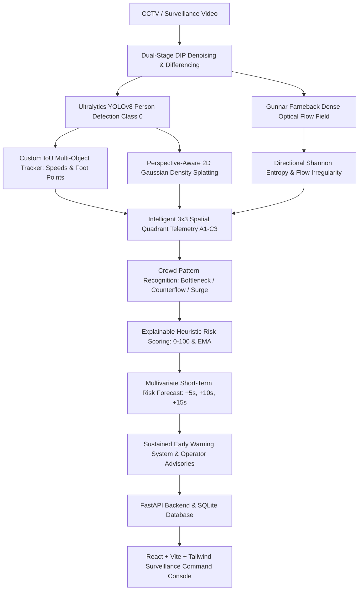
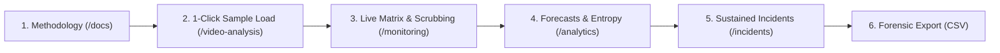

# CROWDGUARD v2.0 — Digital Image Processing (DIP) Crowd Monitoring & Disaster Risk Assessment System


An explainable computer vision and digital image processing surveillance command platform. The system processes CCTV footage, detects and tracks individuals, calculates perspective-normalized continuous density heatmaps, extracts Gunnar Farneback dense optical flow fields and directional Shannon entropy, recognizes crowd motion patterns (bottlenecks, counterflow, panic surges), computes a transparent $0–100$ heuristic risk score, and generates short-term ($+5\text{s}, +10\text{s}, +15\text{s}$) predictive trend alerts with actionable operator recommendations.

---

## 1. Project Overview & Intended Users

CROWDGUARD is designed for:
- **Surveillance Operators & Venue Dispatchers:** Monitoring live or recorded multi-camera feeds at transit hubs, stadiums, and public gatherings.
- **Safety Analysts & Event Coordinators:** Auditing crowd flow bottlenecks, ingress/egress corridor saturation, and evacuation compliance.
- **Computer Vision & DIP Researchers:** Investigating explainable heuristic risk estimation, spatial quadrant density splatting, and directional Shannon entropy.

---

## 2. Problem Statement & Objectives

Public crowd disasters (crushes, stampedes, progressive crowd collapse) often develop gradually due to geometric choke points, bi-directional counterflow turbulence, or uncontrolled entry surges before sudden failure occurs. Traditional surveillance relies either on manual human observation (prone to fatigue) or black-box deep learning models that lack explainability.

**Core Objectives:**
1. **WHAT is happening?** Quantify person counts, velocity, acceleration, and optical flow magnitude.
2. **WHERE is it happening?** Segment scene into an interactive $3 \times 3$ tactical spatial grid (Zones A1–C3) with localized inflow/outflow metrics.
3. **WHY is it considered hazardous?** Compute a transparent $0–100$ composite risk index decomposed into 4 explainable components: Density Pressure (35%), Surge Influx (20%), Motion Anomaly (25%), and Grid Congestion (20%).
4. **WHAT is likely to happen next?** Extrapolate short-term predictive risk trends ($+5\text{s}, +10\text{s}, +15\text{s}$) to give human operators critical early intervention time.

---

## 3. Feature Classification

| Status | Feature | Implementation Detail |
| :--- | :--- | :--- |
| **Implemented & Tested** | YOLOv8 Person Detection | Filtered strictly to COCO Class 0 (`person`) with auto CPU/CUDA execution. |
| **Implemented & Tested** | Dual-Stage DIP Denoising | Bilateral edge-preserving filtering + morphological opening temporal differencing. |
| **Implemented & Tested** | Gunnar Farneback Optical Flow | Dense $(u, v)$ velocity field, mean magnitude, and spatial velocity variance. |
| **Implemented & Tested** | Directional Shannon Entropy | Binned into 8 angular sectors ($45^\circ$) to quantify laminar flow vs. turbulence. |
| **Implemented & Tested** | Perspective Density Splatting | 2D continuous Gaussian splatting ($61 \times 61$) with adaptive vertical Y-scaling. |
| **Implemented & Tested** | Custom Multi-Object Tracker | Persistent IDs, displacement speed ($\text{px/s}$), acceleration, and zone transitions. |
| **Implemented & Tested** | $3 \times 3$ Spatial Quadrant HUD | Real-time population, normalized density, inflow, outflow, and local hazard state. |
| **Implemented & Tested** | Heuristic Risk Index | Transparent $0–100$ scoring with exponential moving average (EMA) smoothing. |
| **Implemented & Tested** | Sustained Incident Engine | Requires multi-frame condition sustenance with cooldowns and operator advisories. |
| **Implemented & Tested** | Privacy Anonymization | Bilateral face blurring and bounding-box silhouette masking (no biometric matching). |
| **Implemented & Tested** | Forensic Audit Export | Standardized CSV export of video metadata, frame telemetry, and incident history. |
| **Experimental** | Short-Term Trend Forecast | Physical time-aware linear-quadratic extrapolation for $+5\text{s}, +10\text{s}, +15\text{s}$. |
| **Future Work** | Stereoscopic Photogrammetry | Calibrated metric 3D ground-plane transformation for true $\text{persons/m}^2$. |
| **Future Work** | Deep Spatio-Temporal Models | Labeled real-world stampede benchmark dataset training (e.g. Graph Neural Networks). |

---

## 4. System Architecture



---

## 5. Software Architecture

- **Backend:** Python 3.11, FastAPI, Uvicorn, OpenCV (`opencv-python`), Ultralytics YOLOv8, NumPy, SciPy, SQLAlchemy, SQLite.
- **Frontend:** React 19, TypeScript, Vite, Tailwind CSS, Recharts, Lucide React, Axios, React Router v7.
- **Data Persistence:** Local SQLite database (`data/surveillance.db`) with tables for `videos`, `analyses`, `frame_records`, and `incidents`.
- **Media Storage:** Processed annotated H.264 MP4 videos, evidence keyframe thumbnails, and CSV audit reports anchored under `data/`.

---

## 6. Digital Image Processing (DIP) Mathematical Formulation

### 1. Gunnar Farneback Dense Optical Flow
Approximates neighborhood pixels with quadratic polynomials:
$$f_1(\mathbf{x}) \approx \mathbf{x}^T \mathbf{A}_1 \mathbf{x} + \mathbf{b}_1^T \mathbf{x} + c_1, \quad f_2(\mathbf{x}) = f_1(\mathbf{x} - \mathbf{d})$$
Resolving displacement vector field $\mathbf{d} = (u, v)$ across consecutive grayscale frames:
$$|\mathbf{v}| = \sqrt{u^2 + v^2}, \quad \theta = \operatorname{atan2}(v, u) \in [0, 2\pi)$$

### 2. Directional Shannon Entropy
Evaluates angular disorder by binning moving vectors ($|\mathbf{v}| > 0.8\text{ px}$) into $N=8$ discrete sectors of $45^\circ$:
$$p_i = \frac{\text{count}(\theta \in \text{sector}_i)}{\sum \text{moving vectors}}, \quad H = -\sum_{i=1}^{8} p_i \log_2(p_i + \epsilon), \quad H_{\text{norm}} = \frac{H}{\log_2(8)}$$
- $H_{\text{norm}} \approx 0.0$: Uniform, coordinated laminar crowd movement.
- $H_{\text{norm}} > 0.68$: Turbulent, chaotic multi-directional motion (potential panic, cross-flow, or disorder).

### 3. Perspective-Aware 2D Continuous Gaussian Density Splatting
For $N$ detected persons with foot points $(x_k, y_k)$:
$$D(x, y) = \sum_{k=1}^{N} \exp\left( -\frac{(x - x_k)^2 + (y - y_k)^2}{2\sigma_k^2} \right) \cdot w_{\text{persp}}(y_k)$$
where vertical ground coordinate $y_k \in [0, H]$ scales the perspective factor:
$$w_{\text{persp}}(y) = 1.0 + (1.0 - y / H) \cdot (w_{\text{config}} \times 0.8)$$
People farther away near the horizon receive proportional density scaling to compensate for optical monocular perspective shrinkage.

---

## 7. Explainable Risk Formula & Configurable Weights

$$\text{Risk}_{\text{raw}} = 100 \times \left( w_d \cdot D_{\text{comp}} + w_g \cdot G_{\text{comp}} + w_m \cdot M_{\text{comp}} + w_c \cdot C_{\text{comp}} \right)$$

1. **Density Component ($D_{\text{comp}} \in [0, 1]$):** Normalized occupancy count and peak spatial quadrant concentration.
2. **Surge Influx Component ($G_{\text{comp}} \in [0, 1]$):** Positive gradient delta in rolling temporal count history.
3. **Motion Anomaly Component ($M_{\text{comp}} \in [0, 1]$):** High optical flow velocity or severe standstill bottleneck ($v < 0.5\text{ px/s}$ under high density).
4. **Congestion Component ($C_{\text{comp}} \in [0, 1]$):** Spatial clustering ratio into a single quadrant.

**Temporal Smoothing:**
$$\text{Risk}_{\text{smoothed}}(t) = \alpha \cdot \text{Risk}_{\text{raw}}(t) + (1 - \alpha) \cdot \text{Risk}_{\text{smoothed}}(t - 1) \quad (\alpha = 0.30)$$

**Risk Bands:** Low ($0–25$), Moderate ($25–50$), High ($50–75$), Critical ($75–100$).

---

## 8. Forecasting Methodology & Validation Limitations

**Methodology:**
Short-term forecast horizons ($\Delta t \in \{5\text{s}, 10\text{s}, 15\text{s}\}$) project future risk using the measured sample interval ($\Delta t_{\text{sample}} = \text{stride} / \text{fps}$):
$$\hat{R}(t + \Delta t) = \operatorname{clip}\left( R(t) + \frac{dR}{dt} \cdot \Delta t \cdot M_{\text{pattern}}, \; 0, \; 100 \right)$$
where $M_{\text{pattern}}$ is a heuristic hazard multiplier (e.g. $1.25$ for `BOTTLENECK` or `RAPID_SURGE`).

**Scientific Integrity & Validation Limitations:**
> [!IMPORTANT]
> **No Validated Disaster Dataset:** Real-world crowd disasters (e.g. stampedes) lack standardized, calibrated CCTV benchmark datasets with frame-by-frame ground truth disaster labels.
> The forecast generated by CROWDGUARD is an **uncalibrated trend projection**, not a certified estimate of disaster probability.
> The forecast evaluation script (`backend/app/utils/evaluate_forecasts.py`) benchmarks mathematical extrapolation error against future observed composite risk on held-out video sequences. Real-world predictive accuracy remains unverified.

---

## 9. Local Installation & Startup Commands

### Windows (PowerShell)
```powershell
# 1. Clone repository
git clone https://github.com/shrutirai29/dip.git
cd dip

# 2. Setup Python environment
python -m venv venv
.\venv\Scripts\activate
pip install -r backend/requirements.txt

# 3. Start Backend Server (Port 8000)
uvicorn app.main:app --app-dir backend --host 127.0.0.1 --port 8000

# 4. In a separate terminal, start Frontend (Port 5173)
cd frontend
npm install
npm run dev -- --host 127.0.0.1 --port 5173
```

### Linux / Kali Linux (Bash)
```bash
# 1. Clone repository
git clone https://github.com/shrutirai29/dip.git
cd dip

# 2. Setup Python environment
python3 -m venv venv
source venv/bin/activate
pip install -r backend/requirements.txt

# 3. Start Backend Server (Port 8000)
uvicorn app.main:app --app-dir backend --host 127.0.0.1 --port 8000

# 4. In a separate terminal, start Frontend (Port 5173)
cd frontend
npm install
npm run dev -- --host 127.0.0.1 --port 5173
```

- API Base: `http://127.0.0.1:8000`
- Interactive Swagger Documentation: `http://127.0.0.1:8000/docs`
- Frontend Command Console: `http://localhost:5173`

---

## 10. Core API Endpoints

| Method | Endpoint | Description |
| :--- | :--- | :--- |
| `GET` | `/api/health` | System health check and API version status. |
| `POST` | `/api/videos/upload` | Validates and streams video uploads (MP4, AVI, MOV, MKV). |
| `GET` | `/api/videos/samples` | Lists available preset demonstration scenario videos. |
| `POST` | `/api/videos/samples/{name}/ingest` | 1-click loads server sample videos into catalog. |
| `POST` | `/api/analyses` | Initiates asynchronous video processing with DIP configuration. |
| `GET` | `/api/analyses/{id}` | Polls real-time progress, FPS, and processing status. |
| `GET` | `/api/analyses/{id}/results` | Retrieves complete frame-by-frame telemetry, flow, and entropy. |
| `GET` | `/api/analyses/{id}/export` | Generates standardized forensic CSV audit report. |
| `GET` | `/api/incidents` | Lists sustained early-warning alerts with optional severity filters. |
| `PATCH` | `/api/incidents/{id}` | Updates incident status (Acknowledged, Resolved) and operator notes. |
| `GET` | `/api/analytics/summary` | Global surveillance analytics (total videos, incidents, peak crowds). |

---

## 11. Sample Video Generation & Usage

Generate synthetic CCTV benchmark scenarios for testing:
```bash
python backend/app/utils/generate_sample.py
```
Outputs generated under `data/sample_videos/`:
1. `crowd_bottleneck_demo.mp4`: Flow convergence and central passage choke point.
2. `crowd_counterflow_demo.mp4`: Opposing pedestrian streams passing through each other.
3. `crowd_panic_demo.mp4`: Sudden velocity surge with high directional Shannon entropy.

---

## 12. Automated Quality Gates & Verified Test Results

### 1. Backend Service & API Test Suite
Command:
```bash
pytest backend/tests/test_services.py backend/tests/test_api.py
```
**Actual Observed Execution Output:**
```text
============================= test session starts =============================
platform win32 -- Python 3.11.9, pytest-8.3.4, pluggy-1.6.0
rootdir: C:\Users\shrut\Documents\antigravity\modest-pascal
configfile: pytest.ini
plugins: anyio-4.15.1
collected 22 items

backend\tests\test_services.py ..............                            [ 63%]
backend\tests\test_api.py ........                                       [100%]

======================= 22 passed, 5 warnings in 12.13s =======================
```

### 2. Live Full Integration Pipeline Test
Command:
```bash
cmd /c "set CROWDGUARD_RUN_E2E=1&& pytest backend/tests/test_e2e_integration.py -s"
```
**Actual Observed Execution Output:**
```text
[1] Uploading video...
 -> Uploaded: vid_0775552f61, 10.0s, 250 frames, 25.0 fps
[2] Creating analysis job with DIP perspective & privacy...
 -> Analysis created: anl_f1a351ace7, status: pending
[3] Polling progress until completed...
 -> Progress: 31.2% | Frame: 78/250 | Status: processing | FPS: 11.5
 -> Progress: 67.2% | Frame: 168/250 | Status: processing | FPS: 11.0
 -> Progress: 100.0% | Frame: 248/250 | Status: completed | FPS: 10.6
 -> Job Completed! Peak Count: 1, Avg Risk: 13.8, Dominant Pattern: NORMAL_FLOW
[4] Fetching frame-by-frame telemetry...
 -> Received 125 recorded frame telemetry objects.
[5] Fetching incidents...
 -> Found 4 sustained incidents generated for session.
[6] Testing CSV export...
 -> CSV export verified successfully!
ALL 6 PIPELINE INTEGRATION STEPS PASSED PERFECTLY!
============================= 1 passed in 12.47s ==============================
```

### 3. Forecast Verification Benchmark
Command:
```bash
python backend/app/utils/evaluate_forecasts.py
```
**Actual Observed Execution Output:**
```json
{
  "total_video_catalogs": 2,
  "development_videos": 1,
  "held_out_evaluation_videos": 1,
  "horizons": {
    "+5s": {
      "valid_points": 75,
      "missing_points": 50,
      "model_mae": 27.8,
      "model_rmse": 35.67,
      "persistence_baseline_mae": 11.12,
      "persistence_baseline_rmse": 12.86
    },
    "+10s": {
      "valid_points": 12,
      "missing_points": 113,
      "model_mae": 27.21,
      "model_rmse": 35.89,
      "persistence_baseline_mae": 16.99,
      "persistence_baseline_rmse": 17.03
    },
    "+15s": {
      "valid_points": 0,
      "missing_points": 125,
      "model_mae": null,
      "model_rmse": null
    }
  }
}
```

### 4. Frontend Production Build Check
Command:
```bash
npm --prefix frontend run build
```
**Actual Observed Output:**
```text
> frontend@0.0.0 build
> tsc -b && vite build

vite v8.3.4 building client environment for production...
transforming...
✓ 2553 modules transformed.
rendering chunks...
computing gzip size...
dist/index.html                   0.45 kB │ gzip:   0.29 kB
dist/assets/index-bejauIWH.css   32.23 kB │ gzip:   6.38 kB
dist/assets/index-89kELKQn.js   759.04 kB │ gzip: 225.59 kB
✓ built in 964ms
```

---

## 13. Ethical Safeguards & Privacy Preservation

1. **No Biometric Identification:** CROWDGUARD contains no face recognition, identity databases, criminal record cross-referencing, or individual biometric profiling.
2. **Configurable Privacy Anonymization:**
   - `face_blur`: Applies heavy Gaussian blurring to head/face ROIs.
   - `full_anonymize`: Overlays solid dark privacy silhouettes directly onto detected persons.
3. **Advisory Decision Support Only:** All alerts are advisory early warnings intended for human operators. The system does not actuate autonomous barriers or physical locks.

---

## 14. Troubleshooting & Common Setup Issues

- **OpenCV Video Codec Errors on Windows:** If MP4 encoding fails, ensure Windows Media Feature Pack is installed. CROWDGUARD automatically falls back from `mp4v` to `XVID`.
- **YOLO First Run:** Ultralytics automatically downloads `yolov8n.pt` (~6.2MB) on first execution. If running offline, pre-download `yolov8n.pt` and place it in the project root.
- **Port Conflicts:** If port 8000 or 5173 is occupied, specify `--port <PORT>` in `uvicorn` and `npm run dev -- --port <PORT>`.

---

## 15. Faculty 2–3 Minute Demonstration Guide



1. **Methodology Formulation (`/docs`):** Walk through Farneback flow equations, directional Shannon entropy, and perspective density splatting.
2. **Video Ingestion Studio (`/video-analysis`):** Click any preset demo scenario (e.g. `crowd_bottleneck_demo.mp4`), configure perspective weight ($1.2$) and privacy mode (`face_blur`), then click **Launch Computer Vision Pipeline**.
3. **Multi-Channel Telemetry (`/monitoring`):** View annotated video playback with green bounding boxes, speed tags, yellow trajectories, and JET density heatmap. Click quadrants on the **Spatial $3 \times 3$ Grid Matrix** (Zones A1–C3) and scrub the synchronized timeline.
4. **Dynamics & Forecasts (`/analytics`):** Inspect $+5\text{s}, +10\text{s}, +15\text{s}$ forecast trajectories and directional Shannon entropy graph.
5. **Incidents & Forensic Export (`/incidents`):** Review sustained hazard cards, click **Inspect** to review evidence keyframes, add operator notes, update status to **Acknowledged**, and download the audit CSV report.
