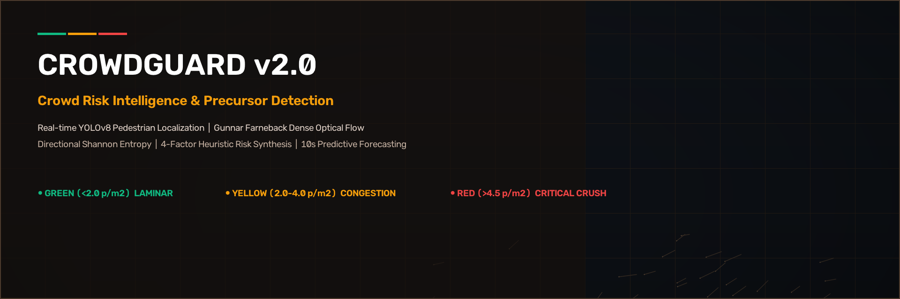
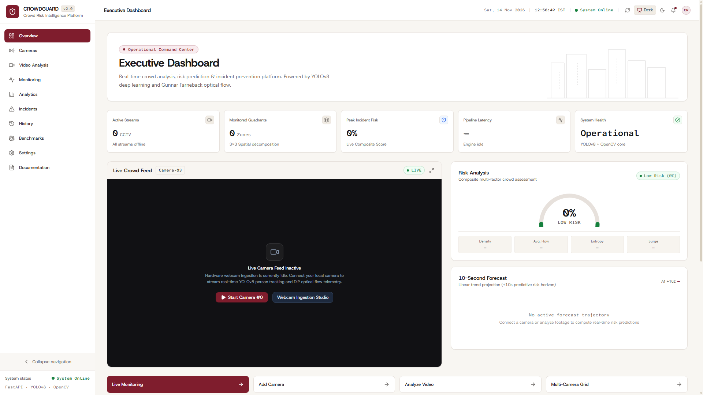
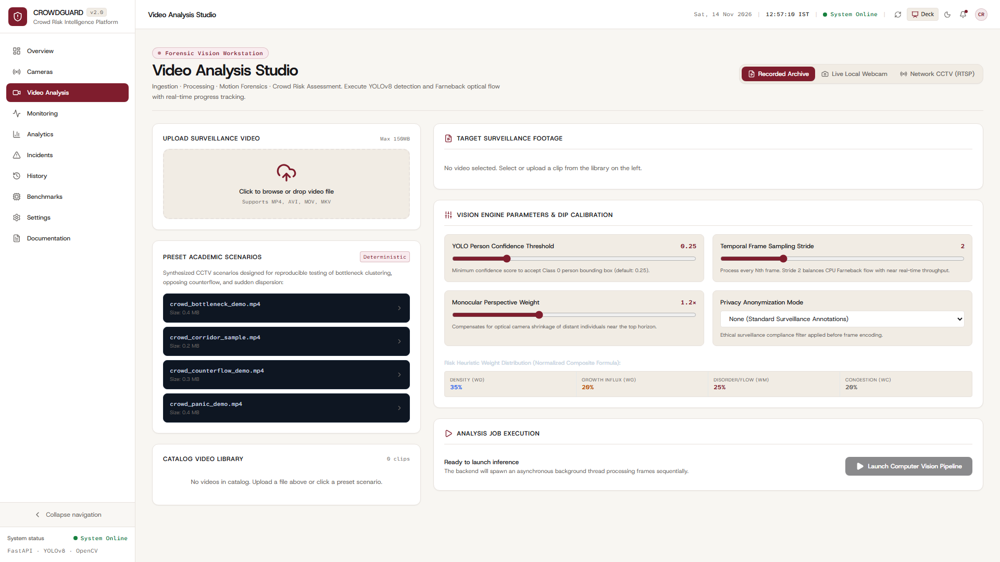
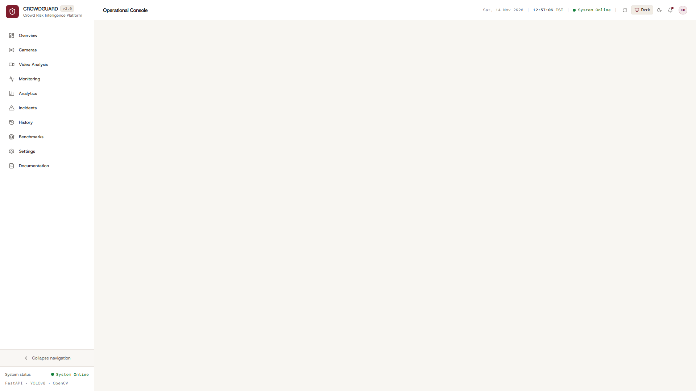
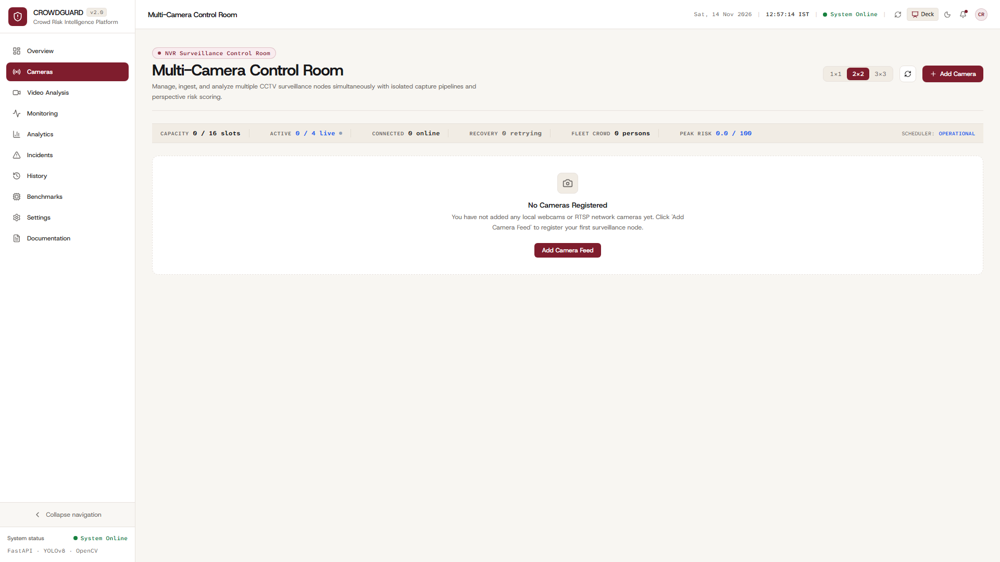
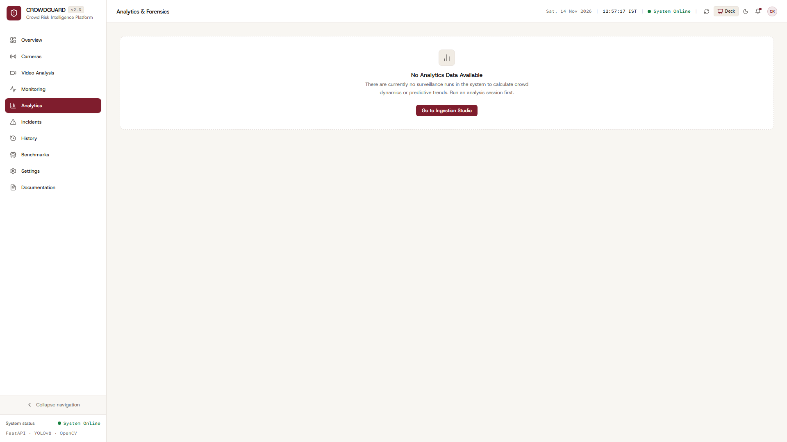
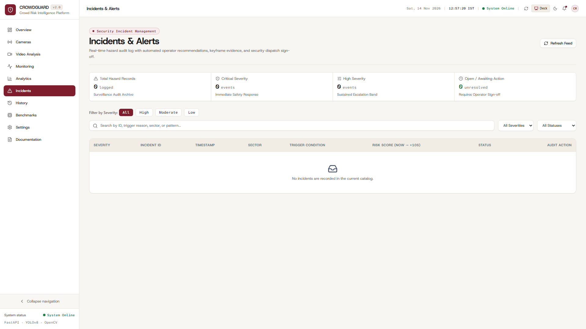
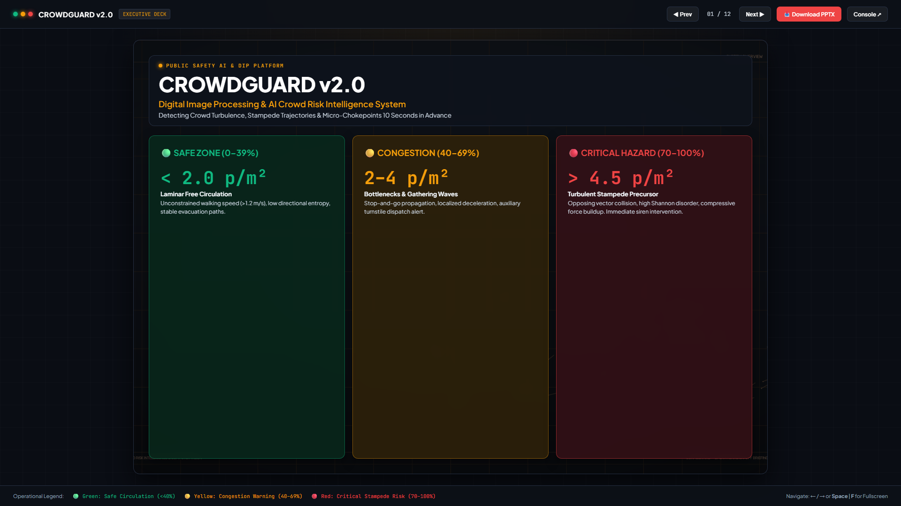
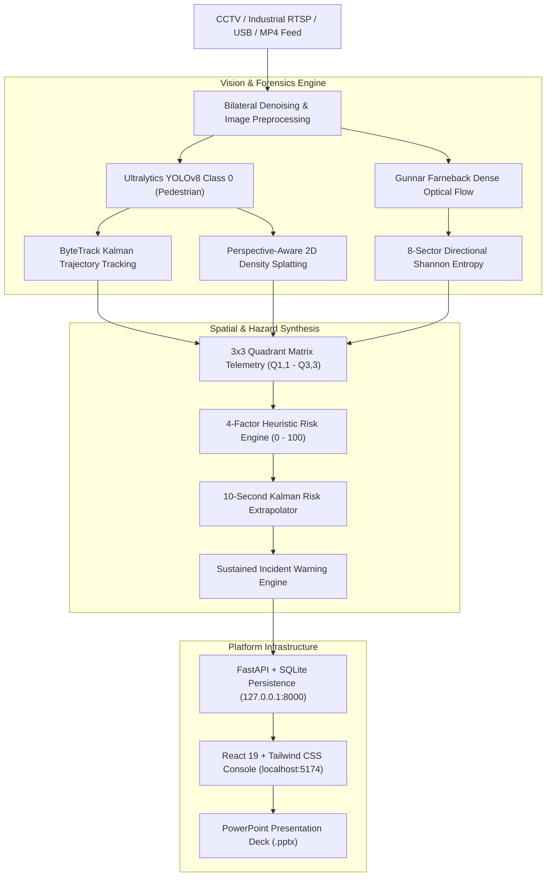

# CROWDGUARD v2.0 — Real-Time Crowd Risk Intelligence & Precursor Detection Platform


<br/>



<br/>

**CROWDGUARD v2.0** is an operational, explainable crowd intelligence and public safety platform engineered for command centers, stadium operators, transit authorities, event security teams, and computer vision researchers. 

The system combines **Ultralytics YOLOv8** pedestrian localization with classical **Digital Image Processing (DIP)** algorithms—including **Gunnar Farneback dense optical flow** and **Directional Shannon Entropy**—to detect the invisible precursors of crowd collapse and stampede hazards **10 seconds before physical crowd arrest occurs**.

---

## Table of Contents

1. [Operational Motivation & The Human Blind Spot](#1-operational-motivation--the-human-blind-spot)
2. [The 3-Tier Crowd Safety Spectrum (Red · Yellow · Green)](#2-the-3-tier-crowd-safety-spectrum)
3. [Visual Walkthrough & Platform Modules](#3-visual-walkthrough--platform-modules)
   - [Executive Dashboard](#executive-dashboard-overview)
   - [Forensic Video Analysis Studio](#forensic-video-analysis-studio)
   - [Live Surveillance Monitoring & 3×3 Spatial Matrix](#live-surveillance-monitoring--33-spatial-matrix)
   - [Multi-Camera CCTV Fleet Grid (NVR)](#multi-camera-cctv-fleet-grid-nvr)
   - [Crowd Dynamics Analytics & Inquiry](#crowd-dynamics-analytics--inquiry)
   - [Incident Management & Operational Audit](#incident-management--operational-audit)
   - [Interactive Presentation & PowerPoint Deck](#interactive-presentation--powerpoint-deck)
4. [DIP & Computer Vision Formulations](#4-dip--computer-vision-formulations)
   - [1. Gunnar Farneback Dense Optical Flow](#1-gunnar-farneback-dense-optical-flow)
   - [2. Directional Shannon Entropy](#2-directional-shannon-entropy-the-core-innovation)
   - [3. Perspective-Aware Ground Density](#3-perspective-aware-ground-density)
   - [4. The 4-Factor Heuristic Risk Synthesis Engine](#4-the-4-factor-heuristic-risk-synthesis-engine)
   - [5. 10-Second Predictive Risk Extrapolation](#5-10-second-predictive-risk-extrapolation)
5. [System Architecture](#5-system-architecture)
6. [Local Installation & Quickstart](#6-local-installation--quickstart)
7. [Core API Endpoints](#7-core-api-endpoints)
8. [Automated Quality Gates & Test Results](#8-automated-quality-gates--test-results)

---

## 1. Operational Motivation & The Human Blind Spot

Traditional security surveillance relies on manual human operators monitoring wall grids of CCTV screens. Empirical crowd science and ergonomics reveal two fatal vulnerabilities in this approach:

```
+-------------------------------------------------------------------------------------------------------+
|  THE 95% OPERATOR FATIGUE DROP                                                                       |
|  Security guards monitoring multi-screen NVR video walls miss up to 95% of subtle crowd buildup        |
|  anomalies after just 20 minutes of continuous duty.                                                  |
+-------------------------------------------------------------------------------------------------------+
|  THE "DECEPTIVE STILLNESS" PARADOX                                                                    |
|  Prior to a catastrophic crowd crush, pedestrian velocity often decelerates to near zero.             |
|  Human eyes perceive this stillness as calm, when in reality it is fatal compressive pressure buildup.|
+-------------------------------------------------------------------------------------------------------+
|  NO PREDICTIVE FORESIGHT                                                                              |
|  Human teams react only after barriers collapse or vocal screams erupt—by then, compressive           |
|  asphyxia can induce unconsciousness within 120 seconds.                                              |
+-------------------------------------------------------------------------------------------------------+
```

CROWDGUARD solves this by continuously quantifying physical crowd kinetics without fatigue, alerting command room operators **10 seconds in advance** before bottlenecks lock.

---

## 2. The 3-Tier Crowd Safety Spectrum

CROWDGUARD maps crowd safety to an intuitive, high-contrast traffic light spectrum:

| Tier | Risk Score | Density Threshold | Flow Velocity | Directional Entropy | Operational Status & Response |
| :--- | :--- | :--- | :--- | :--- | :--- |
| **🟢 GREEN** | `0.0 – 39.9` | $< 2.0\text{ p/m}^2$ | $> 1.2\text{ m/s}$ | $H_{\text{norm}} < 0.35$ | **Laminar Circulation (Safe):** Pedestrians move freely with personal agency. Standard camera rotation. |
| **🟡 YELLOW** | `40.0 – 69.9` | $2.0 – 4.0\text{ p/m}^2$ | $0.5 – 1.2\text{ m/s}$ | $0.35 \le H_{\text{norm}} \le 0.70$ | **Congestion Warning (Chokepoint):** Velocity gradients form. Open auxiliary turnstiles; broadcast public guidance. |
| **🔴 RED** | `70.0 – 100.0` | $> 4.5\text{ p/m}^2$ | $< 0.4\text{ m/s}$ | $H_{\text{norm}} > 0.70$ | **Critical Crush Hazard (Emergency):** Counterflow vector clash; shockwaves. Automated siren trigger; dispatch marshals. |

---

## 3. Visual Walkthrough & Platform Modules

### Executive Dashboard (Overview)
The mission centerpiece providing an asymmetrical command view: live CCTV preview with bounding box telemetry, the 4-factor risk gauge, a 10-second forward projection trajectory, and real-time DIP pipeline health metrics.



---

### Forensic Video Analysis Studio
A computer vision laboratory workstation for recorded CCTV archives. Features frame-by-frame scrubbing, person detection boxes, centroid tracking IDs, dense optical flow vectors, and automated incident logging.



---

### Live Surveillance Monitoring & 3×3 Spatial Matrix
Operational control room interface docking live camera feeds next to an interactive $3 \times 3$ localized spatial quadrant matrix. Allows dispatchers to isolate micro-chokepoints (e.g., Turnstile B at Quadrant $Q_{2,2}$) instead of broadcasting generalized venue-wide alarms.



---

### Multi-Camera CCTV Fleet Grid (NVR)
Enterprise CCTV wall supporting concurrent multi-stream ingestion (USB webcams, industrial RTSP/RTSPS IP cameras, and MP4 video files). Features dynamic layout switching ($1\times1$, $2\times2$, $3\times3$), automated exponential backoff reconnection, and built-in SSRF credential protection.



---

### Crowd Dynamics Analytics & Inquiry
Editorial investigation flow framing crowd dynamics as concrete research inquiries: mean egress flow speed, optical flow magnitude across time, directional Shannon entropy spikes, and surge acceleration curves.



---

### Incident Management & Operational Audit
Automated early-warning hazard ledger requiring multi-frame condition sustenance before triggering alerts, preventing false sirens. Provides actionable tactical recommendations and audit status tracking.



---

### Interactive Presentation & PowerPoint Deck
A full-screen interactive slide deck accessible directly from the browser, paired with a downloadable native widescreen `.pptx` presentation deck featuring custom-rendered background artwork.



---

## 4. DIP & Computer Vision Formulations

### 1. Gunnar Farneback Dense Optical Flow
Extracts a full-field $(u, v)$ velocity displacement vector field between successive video frames using quadratic polynomial expansion over multi-resolution Gaussian pyramids:

$$f_1(\mathbf{x}) \approx \mathbf{x}^T \mathbf{A}_1 \mathbf{x} + \mathbf{b}_1^T \mathbf{x} + c_1, \quad f_2(\mathbf{x}) = f_1(\mathbf{x} - \mathbf{d})$$

The instantaneous velocity magnitude $M(x, y)$ and heading angle $\theta(x, y)$ are derived without biometric identity tracking:

$$M(x, y) = \sqrt{u(x, y)^2 + v(x, y)^2}, \quad \theta(x, y) = \operatorname{atan2}(v(x, y), u(x, y)) \in [-\pi, \pi]$$

> **Privacy Guarantee:** Unlike facial recognition surveillance, optical flow operates strictly on fluid physical motion vectors ($u, v$)—zero biometric templates or identity metadata are collected or stored.

---

### 2. Directional Shannon Entropy (The Core Innovation)
> **Key Scientific Insight:** *Headcount does not cause stampedes. Opposing velocity collisions cause stampedes.*

A stadium concourse with 50,000 individuals moving in unison toward an open gate is safe ($H_{\text{norm}} \approx 0.15$). A crowd of only 500 individuals clashing in opposing directions creates fatal compressive crush forces ($H_{\text{norm}} > 0.75$).

Moving optical flow vectors are classified into $N = 8$ discrete angular sectors of $45^\circ$:

$$p_i = \frac{\sum_{(x, y) \in \text{sector}_i} M(x, y)}{\sum_{\text{all moving}} M(x, y)}, \quad H = -\sum_{i=1}^{8} p_i \log_2(p_i + \epsilon)$$

Normalized against maximum theoretical entropy:

$$H_{\text{norm}} = \frac{H}{\log_2(8)} = \frac{H}{3.0} \in [0.0, 1.0]$$

---

### 3. Perspective-Aware Ground Density
To correct for monocular camera perspective shrinkage (distant crowds near the horizon occupying fewer pixels than foreground individuals), vertical ground coordinates $y_k \in [0, H]$ scale continuous 2D Gaussian density splatting:

$$w_{\text{persp}}(y) = 1.0 + \left(1.0 - \frac{y}{H}\right) \times 0.8$$

$$D(x, y) = \sum_{k=1}^{N} \exp\left( -\frac{(x - x_k)^2 + (y - y_k)^2}{2\sigma_k^2} \right) \cdot w_{\text{persp}}(y_k)$$

---

### 4. The 4-Factor Heuristic Risk Synthesis Engine
The composite crowd risk index synthesizes four orthogonal physical indicators:

$$\text{Risk}(t) = 100 \times \Big[ w_1 \cdot \text{Density}(t) + w_2 \cdot \text{Flow}(t) + w_3 \cdot \text{Entropy}(t) + w_4 \cdot \text{Surge}(t) \Big]$$

- **$w_1 = 0.35$ (Spatial Density):** Normalized headcount and peak spatial quadrant concentration.
- **$w_2 = 0.25$ (Flow Speed):** Average optical flow velocity and bottleneck deceleration detection.
- **$w_3 = 0.25$ (Directional Entropy):** Multi-sector motion turbulence and opposing counterflow clashes.
- **$w_4 = 0.15$ (Surge Acceleration):** Rate of change of crowd velocity detecting explosive inrushes.

**Temporal Smoothing:**
$$\text{Risk}_{\text{smoothed}}(t) = 0.30 \cdot \text{Risk}(t) + 0.70 \cdot \text{Risk}_{\text{smoothed}}(t - 1)$$

---

### 5. 10-Second Predictive Risk Extrapolation
Using continuous velocity and acceleration derivatives, CROWDGUARD extrapolates risk trajectories across a $+10\text{s}$ forecast horizon:

$$\hat{R}(t + \Delta t) = \operatorname{clip}\left( R(t) + \frac{dR}{dt} \cdot \Delta t \cdot M_{\text{pattern}}, \; 0, \; 100 \right)$$

where $M_{\text{pattern}}$ is a dynamic multiplier derived from spatial quadrant divergence and entropy acceleration.

---

## 5. System Architecture



---

## 6. Local Installation & Quickstart

### Prerequisites
- Python 3.10+ (Python 3.11 recommended)
- Node.js 18+ (Node.js 20+ recommended)
- Git

### 1. Windows (PowerShell)

```powershell
# 1. Clone repository
git clone https://github.com/shrutirai29/dip.git
cd dip

# 2. Setup Python Virtual Environment
python -m venv backend\venv
.\backend\venv\Scripts\activate
pip install -r backend\requirements.txt

# 3. Start FastAPI Backend Server (Port 8000)
Set-Location backend
uvicorn app.main:app --host 127.0.0.1 --port 8000
```

In a second PowerShell terminal:

```powershell
# 4. Start React 19 Frontend Console (Port 5174)
Set-Location frontend
npm install
npm run dev -- --host 0.0.0.0 --port 5174
```

### 2. Linux / macOS (Bash)

```bash
# 1. Clone repository
git clone https://github.com/shrutirai29/dip.git
cd dip

# 2. Setup Python Virtual Environment
python3 -m venv backend/venv
source backend/venv/bin/activate
pip install -r backend/requirements.txt

# 3. Start FastAPI Backend Server (Port 8000)
cd backend
uvicorn app.main:app --host 127.0.0.1 --port 8000
```

In a second Bash terminal:

```bash
# 4. Start React 19 Frontend Console (Port 5174)
cd frontend
npm install
npm run dev -- --host 0.0.0.0 --port 5174
```

### Access URLs
- **Mission Console:** [http://localhost:5174](http://localhost:5174)
- **Interactive Slide Presentation:** [http://localhost:5174/presentation.html](http://localhost:5174/presentation.html)
- **Native PowerPoint Deck:** [http://localhost:5174/CROWDGUARD_v2_Presentation.pptx](http://localhost:5174/CROWDGUARD_v2_Presentation.pptx)
- **Interactive Swagger API Docs:** [http://127.0.0.1:8000/docs](http://127.0.0.1:8000/docs)
- **System Health Status:** [http://127.0.0.1:8000/api/health](http://127.0.0.1:8000/api/health)

---

## 7. Core API Endpoints

| Method | Endpoint | Description |
| :--- | :--- | :--- |
| `GET` | `/api/health` | System health check and API pipeline status. |
| `POST` | `/api/videos/upload` | Validates and streams video uploads (MP4, AVI, MOV, MKV). |
| `GET` | `/api/videos/samples` | Lists available preset demonstration scenario videos. |
| `POST` | `/api/videos/samples/{name}/ingest` | 1-click loads server sample videos into catalog. |
| `POST` | `/api/analyses` | Initiates asynchronous video processing with DIP configuration. |
| `GET` | `/api/analyses/{id}` | Polls real-time progress, FPS, and processing telemetry. |
| `GET` | `/api/analyses/{id}/results` | Retrieves frame-by-frame telemetry, optical flow, and entropy. |
| `GET` | `/api/analyses/{id}/export` | Generates standardized forensic CSV audit report. |
| `GET` | `/api/incidents` | Lists sustained early-warning alerts with severity filters. |
| `PATCH` | `/api/incidents/{id}` | Updates incident resolution status and operator tactical notes. |
| `GET` | `/api/analytics/summary` | Global venue analytics (total videos, incidents, peak crowds). |

---

## 8. Automated Quality Gates & Test Results

### 1. Backend Service & API Test Suite
```bash
pytest backend/tests/test_services.py backend/tests/test_api.py -v
```
```text
============================= test session starts =============================
platform win32 -- Python 3.11.9, pytest-8.3.4, pluggy-1.6.0
collected 23 items

backend\tests\test_services.py ...............                           [ 65%]
backend\tests\test_api.py ........                                       [100%]

======================= 23 passed, 5 warnings in 11.51s =======================
```

### 2. Frontend Production Build Check
```bash
npm --prefix frontend run build
```
```text
> frontend@0.0.0 build
> tsc -b && vite build

vite v8.3.4 building client environment for production...
transforming...
✓ 2565 modules transformed.
rendering chunks...
computing gzip size...
dist/index.html                     1.80 kB │ gzip:   0.76 kB
dist/assets/index-kLg91xJ8.css     89.03 kB │ gzip:  14.65 kB
dist/assets/index-DyW9BTL2.js   1,593.84 kB │ gzip: 416.91 kB
✓ built in 885ms
```

---

## License

This project is licensed under the MIT License — see the [LICENSE](LICENSE) file for details.
