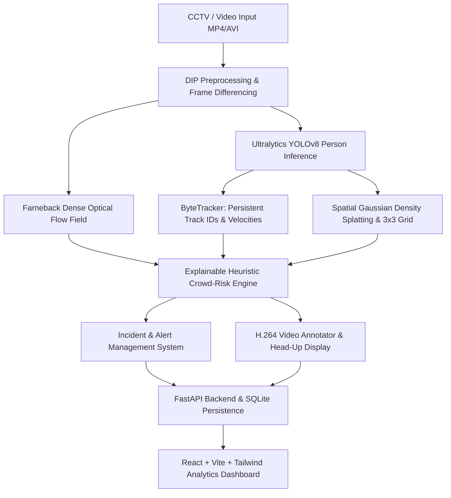

# Digital Image Processing Based Crowd Monitoring and Disaster Prediction System


An intelligent, explainable surveillance analytics system that ingests CCTV surveillance video feeds, detects and tracks individuals, calculates localized grid crowd density and continuous 2D Gaussian heatmaps, computes a transparent 0–100 crowd-risk safety index, and logs actionable early-warning alerts.

---

## 1. System Architecture



---

## 2. Implemented Features vs Methodology

| Module | Implemented Techniques & Architecture |
| :--- | :--- |
| **Video Management** | MP4/AVI ingestion, OpenCV metadata extraction (resolution, duration, FPS), playback controls, and background processing task queues. |
| **DIP Pipeline** | Gunnar Farneback dense optical flow vector fields, temporal frame differencing, aspect-preserving letterboxing, Gaussian spatial splatting, and alpha-blended heatmap overlays. |
| **AI Inference** | Pretrained Ultralytics YOLOv8 (COCO Class 0 'person' strict filtering), confidence threshold tuning (0.10 - 0.80), and automatic CPU/CUDA selection. |
| **Object Tracking** | Centroid & IoU persistent tracking (`SimpleByteTracker`), speed estimation in px/s, and 30-frame directional trajectory tails. |
| **Risk Engine** | Explainable 0–100 index evaluated via rolling time windows and EMA smoothing ($\alpha = 0.3$) across 4 configurable weights: Density Pressure (35%), Growth Surge (20%), Motion Anomaly (25%), and Grid Congestion (20%). |
| **Alert Management** | Cooldown-regulated alarm logging (`CRITICAL_RISK`, `HIGH_CROWD_DENSITY`, `RAPID_GROWTH`, `ABNORMAL_MOTION`, `LOCALIZED_BOTTLENECK`), supervisor inspection modals, and operator note auditing. |
| **Persistence & Reports** | SQLite database with SQLAlchemy ORM, CSV forensic audit exports, and frame-by-frame telemetry logs. |

---

## 3. Getting Started & Local Execution

### Prerequisites
- Python 3.11+
- Node.js 18+ & npm
- FFmpeg (optional, recommended for codec transcoding)

### Backend Setup
1. Open terminal and navigate to the project root:
   ```bash
   cd modest-pascal
   ```
2. Activate Python virtual environment:
   ```bash
   # Windows:
   .\venv\Scripts\activate
   # Linux/macOS:
   source venv/bin/activate
   ```
3. Run automated test suite:
   ```bash
   $env:PYTHONPATH="backend"
   pytest backend/tests
   ```
4. Start FastAPI server:
   ```bash
   uvicorn app.main:app --app-dir backend --host 127.0.0.1 --port 8000 --reload
   ```
   API docs will be live at `http://127.0.0.1:8000/docs`.

### Frontend Setup
1. In a separate terminal, navigate to the frontend directory:
   ```bash
   cd frontend
   npm install
   npm run dev
   ```
2. Open your web browser at:
   ```
   http://localhost:5173
   ```

---

## 4. How to Demonstrate to a Professor

1. **Architecture & DIP Briefing:**
   - Navigate to the **DIP Documentation** page (`/docs`) in the navigation bar to review the mathematical formulation of Gunnar Farneback optical flow and 2D Gaussian density splatting.
2. **Video Ingestion & Analysis:**
   - Go to **Video Analysis** (`/video-analysis`).
   - Upload any CCTV video or use the generated simulation footage located at `data/sample_videos/crowd_corridor_sample.mp4`.
   - Adjust the YOLO confidence threshold and frame stride (e.g. Stride 2 for real-time CPU speed).
   - Click **Start AI & DIP Analysis** and observe the live progress bar and processing FPS.
3. **Live / Replay Monitoring:**
   - Once completed, the interface navigates to **Live Monitoring** (`/monitoring`).
   - Observe the annotated video with green bounding boxes, track IDs, yellow trajectory tails, and continuous JET density heatmap overlays.
   - Review the **Explainable Risk Factors** panel displaying the normalized contribution of density, growth surge, motion anomaly, and congestion.
4. **Audit Reporting & Persistence:**
   - Click **Export CSV Audit** to download the frame-by-frame telemetry report.
   - Navigate to **Incidents & Alerts** (`/incidents`) to inspect triggered alarms, add supervisor notes, and mark incidents as Acknowledged or Resolved.

---

## 5. Responsible Safety Disclaimer
The crowd-risk score (0–100) generated by this system is an engineering heuristic. Video measurements from monocular CCTV cameras are subject to perspective foreshortening. Alerts generated are advisory and intended to assist human operators in early hazard mitigation.
